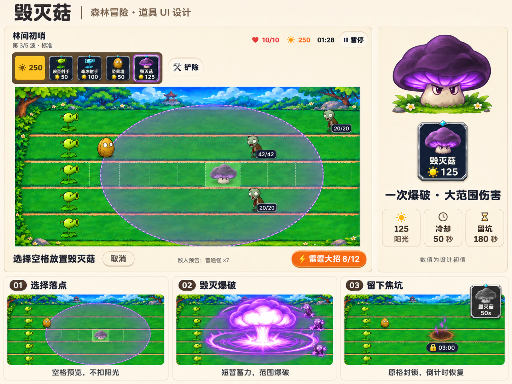
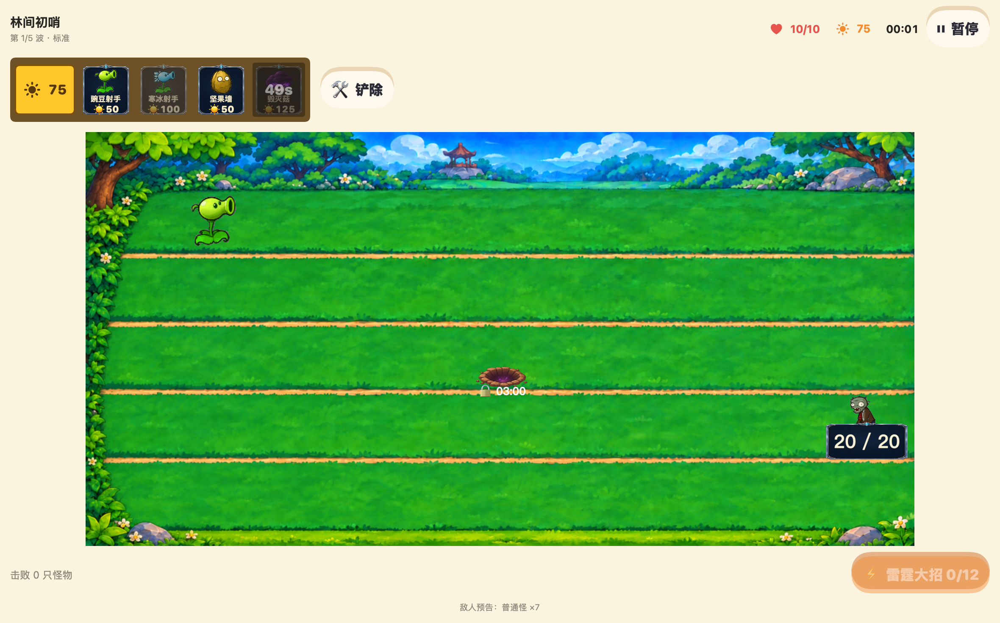

# 毁灭菇 · UI 设计提案

状态：毁灭菇已接入森林冒险。实现基于 `main` / `a8986a5`，2026-11-22；2026-11-23 完成提交前复核。下方设计板保留为概念参考，实际实现见文末运行导出。

2026-11-23 规则扩展：在「收藏馆 → 道具解锁」达到 Lv.3 后花 300 积分永久解锁；每个孩子独立保存拥有记录，旧档不自动赠送。解锁后，经典庭院、林间草坪及森林冒险均可使用。经典模式沿用 125 阳光、1 秒蓄力、120 伤害、50 秒冷却和 180 秒单格焦坑；准备、暂停和回合休息不推进战斗计时，幼儿园三路使用草坪中间三行。击杀不计作答对题目，友方植物保留。下方仅面向冒险的设计板和截图保留为原始实现记录。



主稿沿用最新森林冒险界面，展示选点范围、爆炸和单格焦坑。图中辅助格线与范围轮廓是概念示意，最终实施必须按真实草坪的五行九列坐标计算，不照抄绘图像素。

## 实施与验收安排

1. 核对最新源码，导出已有真实横竖屏界面，更新 [当前 UI 基线](../ui-current/README.md) 并标注历史稿。
2. 按当前森林冒险布局设计种植卡、选点预览、爆炸和坑位封锁，生成一张完整设计板。
3. 首轮仅完成 UI 设计；收到继续指令后，按 [实施计划](../superpowers/plans/2026-11-22-doom-shroom.md) 接入玩法、资源与测试。

## 设计定位与玩法参考

以《植物大战僵尸》一代毁灭菇的“大范围一次性爆炸 + 留坑禁种”为参考。参考资料：[Doom-shroom (PvZ)](https://plantsvszombies.wiki.gg/wiki/Doom-shroom_%28PvZ%29)、[Crater](https://plantsvszombies.wiki.gg/wiki/Crater)。原作的高伤害、约 3.5 格半径、三分钟坑位限制用于理解玩法；本项目的最终伤害不能照抄，因为冒险敌人使用自己的生命数值。

**本次主稿面向森林冒险**：作为种植型一次性道具，进入开局所选四张卡之一，占用一个卡槽，不额外增加第五张。演示卡组为豌豆射手、寒冰射手、坚果墙、毁灭菇。任务分支已支持该组合，默认卡组保持原样。

不把经典模式的冰冻符 / 爱心叶 / 幸运星道具栏搬进冒险，不加入答题、大招答题或付费购买入口。

| 提案参数 | UI 表达 | 状态 |
| --- | --- | --- |
| 消耗 125 阳光 | 卡片底部阳光图标与 `125`，成功落位才扣费 | 设计初值，待玩法平衡 |
| 约 3.5 格爆炸半径 | 以落点为中心的半透明紫色范围，边界外不受影响 | 设计初值，使用实际草坪坐标裁切 |
| 种下约 1 秒后爆炸 | 菌盖膨胀、亮纹聚光、短暂紫白冲击 | 演出时序提案 |
| 单次爆破 | 蘑菇消失，对范围内敌人结算一次 120 伤害 | 当前实现初值；第一关标准首领 160 生命，不能显示“所有首领必杀” |
| 坑位封锁 180 秒 | 原格焦坑 + 小锁 + `03:00` 倒计时 | 沿用原作的设计初值，待关卡节奏验证 |
| 50 秒冷却 | 卡牌灰色遮罩 + `50s`；同时显示阳光不足状态 | 设计初值；不是一次性库存数量 |

当前森林冒险没有昼夜 / 咖啡豆机制，本稿不引入白天睡眠及唤醒流程。爆炸范围内的其他友方植物保留；仅允许放在空格，爆后封锁落点一格。上述适配均为设计提案。

## 操作与状态

- 沿用当前“点卡选中 → 点草坪”和拖动种植的交互方向；选中时卡框发紫光，空格显示落点与范围预览。
- 选点期间保留标题、基地生命、阳光、计时、暂停、四张卡与铲除按钮。底部提示“选择空格放置毁灭菇”，原位提供取消；雷霆大招保持在右侧。
- 预览不扣费、不制造坑。已有植物、已有坑、场外落点用斜线 / 禁止图标和文字提示；无效落点不扣阳光。
- 确认合法落点后扣阳光并进入膨胀动画；提示“一次爆破，原地留下坑位”，避免误以为它是持续射手。
- 爆炸使用紫白蘑菇云与向外扩展的冲击波，保持儿童向卡通表现，场外与安全区不加伤害标记。
- 坑保留在原格，显示锁和剩余时间；铲子不能提前清除。倒计时结束恢复原草坪，恢复 / 暂停须与战斗时间一致。
- 冷却、阳光不足、选中、坑位不可种等状态都用文字或图标补充，不能只靠颜色。

## 美术与交付约束

- 使用 `create-game-assets`、`game-ui-ux` 整理设定，使用内置 `image_gen` 生成评审图。
- 基底直接参考最新真实界面导出，不参考旧三路战斗板。保留暖米色外围、现有纹章卡框、糖果胶囊、林间草坪和角色比例。
- 毁灭菇采用深紫宽菌盖、淡色短菌柄、严肃但不恐怖的眼神；亮紫菌褶用于暗示爆发。小卡面突出菌盖与眼睛。
- 主稿为横屏 UI 与状态分镜的设计板，属于不透明 PNG；不是可直接切片入库的生产纹理，不宣称已实现。
- 后续实施时，膨胀、冲击与烟雾统一使用 `Resources/Effects` 下的 SpriteKit `.sks` 并通过 `FXLibrary` 加载。代码只负责触发、参数与生命周期；视觉不得重复触发伤害。
- 不新增依赖或改变四卡规则。存档新增可选的蓄力 / 焦坑 / 冷却聚合字段，缺字段的旧档按空状态读取；不新增数据库表。

生成提示词、参考输入与最终文件记录于本目录的 `imagegen-prompt.txt`、`asset-manifest.json`；视觉稿待用户评审。

## 首轮 UI 验证

- `AdventureScreenTests` 3 项通过，输出 13 张最新界面图；基于其中的真实横屏战斗图生成本稿。
- 内置 `image_gen` 初稿后针对爆炸范围做了一次修订，最终采用 `doom-shroom-ui.png`；提示词保留在 `imagegen-prompt.txt` 与 `imagegen-refinement.txt`。
- 目检了四卡栏、五路草坪、顶部状态、场外操作区、选点 / 爆炸 / 焦坑、价格与倒计时。没有把设计板当作玩法实现或可直接导入的精灵素材。
- 首轮只更新文档、界面导出和设计板。以下为后续实现阶段的交付。

## 实现与实际运行导出



- [卡栏可用](runtime/landscape-ready.png)、[准备阶段预放](runtime/landscape-charge.png)、[范围预览](runtime/placement-ready.png)、[真实爆炸帧](runtime/engine-blast.png)、[竖屏焦坑](runtime/portrait-crater.png)。
- UI 使用真实 `AdventureScreen`、`NSHostingView` 与 SpriteKit 场景导出；范围图由产品预览组件叠加当前草坪生成。使用内存样例对局，是 macOS 组件与引擎验证，不是 iPad 实机截图。
- 当前实现：125 阳光、1 秒蓄力、120 伤害、半径 3.5 格、50 秒冷却、180 秒焦坑。横向格距为 750/9，纵向为 100；范围预览与伤害使用同一组参数。
- 准备阶段可预放，开战后才计时；已占用、焦坑、冷却或阳光不足不扣费。蓄力菇和焦坑不能铲除；友方植物保留。击杀走原奖励入口，存档恢复不重放已结算爆炸。
- 暂停和结算不推进计时，波间仍推进；倒计时量化为固定步长，避免浮点误差令冷却多显示一秒。选点提示替换原底栏文字，避免增加一行挤动战场。
- `DoomBody.sks`、`DoomExplosion.sks`、`DoomCrater.sks` 经 `FXLibrary` 加载，动画回调不结算伤害。三张透明图来自内置 `image_gen`，提示词和原图见 `asset-prompt.txt`、`asset-source.png`，规范化及 alpha 验证见 `asset-report.json`、`alpha-report.json`。
- `scripts/build-doom-shroom.swift` 仅离线切片、规范化与 SKS 归档；维护源资源直接打包，不在运行时拼装形状或手写粒子循环。
- 当前数值是可调初值；尚未进行 iPad 触摸、性能及六关实战平衡验收。
- 最终全量 `swift test`：LearnGameTests 213 项、LearnCoreTests 194 项，共 407 项通过。iOS 通用模拟器 Debug 目标构建成功；`git diff --check` 通过。
- GitNexus 最终 `detect_changes(scope: all)` 覆盖 224 个变更符号、43 条影响流程，风险为 critical，未报告 partial / truncated；已检查种植、推进、暂停、恢复和共用卡栏，结合完整回归核对。二进制资源另由加载与渲染测试覆盖；摘要见 `graph-report.json`，资源及截图校验见 `runtime-manifest.json`。

导出命令（在 `Packages/LearnKit`）：

```sh
DEVELOPER_DIR=/Applications/Xcode.app/Contents/Developer \
DOOM_PREVIEW="$PWD/../../docs/doom-shroom/runtime" \
swift test --filter AdventureDoomSceneTests
```
