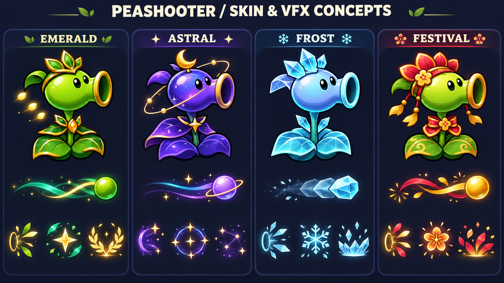
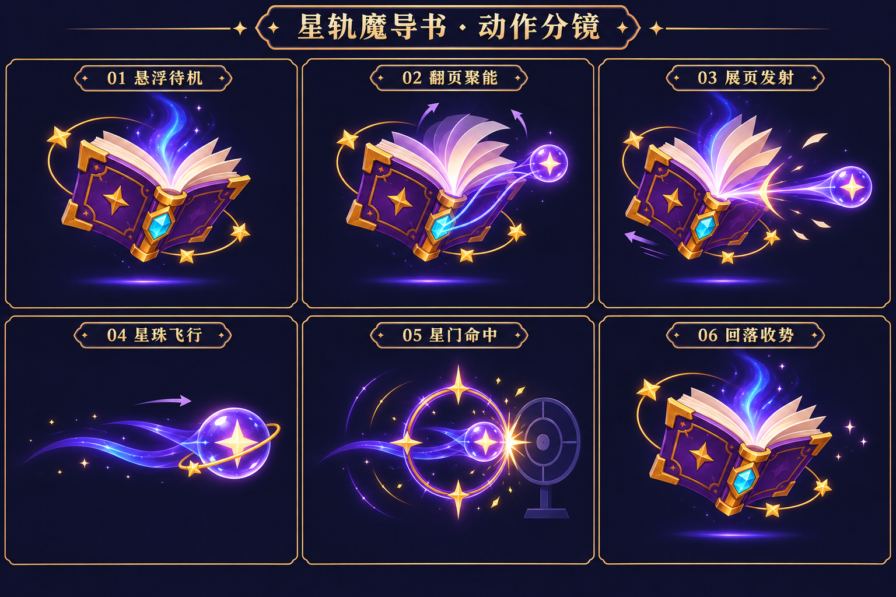

# 皮肤设计档案

保存本次会话已完成的概念图、动作分镜、完整 ImageGen 提示词和 Pinterest 参考链接。图片由内置 ImageGen 生成；源 PNG 原样复制保留。本目录路径均可随仓库迁移。

## 豌豆射手主题

| 主题 | 本体 | 弹体与命中 | 状态 |
| --- | --- | --- | --- |
| 翡翠星使 | 金边叶冠、琥珀种子、环绕种子光 | 双翡翠彗星尾、四瓣星核、月桂光冠 | 概念；通用翡翠彗星特效已实装，完整角色皮肤未制作 |
| 星轨术士 | 紫蓝星纹、弯月饰、倾斜星轨 | 紫色星珠、金环、星门与星座碎光 | 概念 |
| 霜晶骑士 | 晶冠、透明冰叶 | 多面冰种、短残影、六瓣霜纹 | 概念；不增加减速属性 |
| 花火游侠 | 红金花冠、流苏、铜金嘴环 | 琥珀种子、红金飘带、花形礼花 | 概念 |

详细设计与完整提示词：[peashooter-skin-design.json](peashooter-skin-design.json)。该文件同时保存已查看的 Pinterest 参考及原作者页面；参考图片未直接纳入游戏素材。

## 全造型防御单位

| 主题 | 动作与材质 | 状态 |
| --- | --- | --- |
| 星轨魔导书 | 靛紫封面、金属包角、翻页聚能、星珠与星门 | 已实装，提交 `6fc7f8c`；[运行与验收](../spellbook-skin/README.md) |
| 雷霆小机甲 | 乳白装甲、钴蓝面板、线圈通电、炮口展开、电浆胶囊与六边电弧 | 已接入；[运行与验收](../defender-theme-skins/README.md) |
| 云游茶壶 | 青瓷金边、壶盖轻跳、倾斜喷射、茶叶水珠与莲花水光 | 已接入；[运行与验收](../defender-theme-skins/README.md) |

详细设计与完整提示词：[defender-concept-design.json](defender-concept-design.json)。

## 魔导书动作分镜

悬浮待机 → 翻页聚能 → 展页发射 → 星珠飞行 → 星门命中 → 回落收势。分镜用于表达设计意图；实际运行的分层 PNG、SKS、发射时序和回归结果以 `docs/spellbook-skin/` 及对应源码为准。

## 文字阶段的储备方向

这些方向在会话中提出，尚未制作概念图或代码：

- **琥珀幼龙**：蜷坐、摆尾、胸口暖光；鼓脸吐出琥珀火种，翼形短尾焰；命中裂成花形火焰，余烬落下。
- **花火扭蛋机**：透明球仓内弹珠滚动、旋钮转动；胶囊沿轨道进入发射口，命中打开成花瓣和彩纸。
- **墨竹灵笔**：毛笔悬在砚台上、竹叶绕行；挥笔凝成实体墨核，命中压缩后绽成金边墨花。

后续制作继续采用“本体/待机—出膛—弹体/尾迹—命中—退场”的资源槽位。皮肤表现独立于伤害、射速和奖励；新的角色需要独立校准落位点、发射点与显示范围。

## 已完成实现的关联资料

- [SKS 资源化 MVP](../spritekit-fx-mvp/README.md)
- [翡翠彗星 V2](../spritekit-fx-v2/README.md)
- [魔导书实装](../spellbook-skin/README.md)
- [雷霆小机甲与云游茶壶实装](../defender-theme-skins/README.md)

归档日期：2026-11-21。本次归档不代表其他概念皮肤已经实装。
