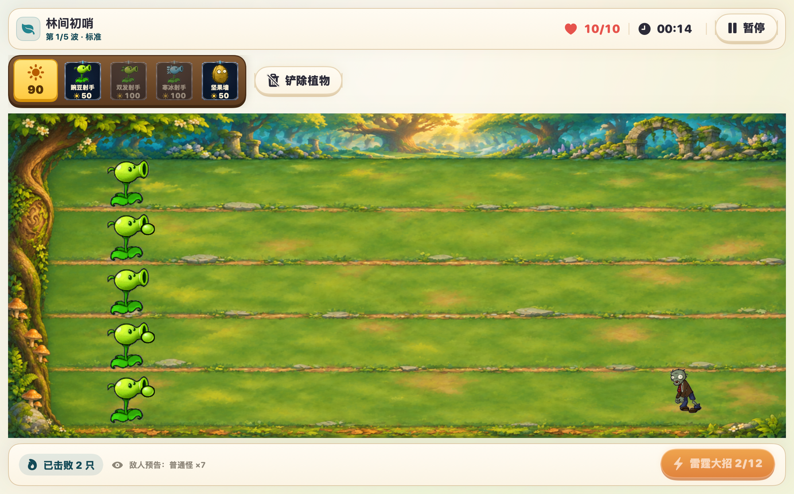

# 当前界面与设计基线

核对日期：2026-11-26。代码基线：`fix/fresh-game-fullscreen-map` / `2c8ad5f`（合入 `main` 的 `fe9733c` 并完成 UI 风格优化 B 档）。

本文记录已经实现的界面。后续设计先核对当前代码和本目录的真实界面导出，再参考历史美术稿。

实现更新：已完成绘本瓷釉四层表面体系（`AppSpacing` / `AppShadow` / `AppMotion` / `appPanel` / `appInset` / `AppModalScaffold`）全站迁移、主页与弹窗样板重排、冒险全屏铺满战场与单条顶栏整合，并基于 `2c8ad5f` 重新导出全部 13 张基线截图（前后端对照见 [UI 风格优化说明](../ui-refresh/README.md)）。

## 两套战斗界面

| 区域 / 行为 | 经典闯关 | 森林冒险 |
| --- | --- | --- |
| 核心规则 | 答对题触发攻击，僵尸题牌用于选题 | 植物自动攻击，敌人牌子显示生命数值 |
| 顶部 | `BattleTopBar` 统一 `.appPanel` 容器容纳植物卡、阳光及 `GameHUD`（`.appInset`），不足时分行 | 关卡名、波次 / 难度、基地生命 `x/10`、战斗时间与暂停 / 返回合并为一条 `.appPanel` 状态栏 |
| 植物卡 | 顶部拖动种植，含独立铁栅门入口 | 独立一行：阳光牌、所选四张植物卡、铲除按钮；卡组在冒险地图准备区选择 |
| 战场 | `GameScene`，地图可切换；横屏可向右扩展 | `AdventureScene`，林间草坪，1200×600 场景全屏铺满显示，五行九列 |
| 战场下方 | 独立 `BattleActionBar`（`.appPanel`）：大招、横向掉落道具、地图名 | 紧凑底栏（`.appPanel`）：击败数量 / 波间倒计时、`雷霆大招 x/12`、敌人预告 |
| 底部答题区 | 横屏左侧竖排切题，右侧答题；竖屏上方横排切题 | 没有答题区，也没有经典掉落道具栏 |
| 准备阶段 | 题库与难度配置、布阵、开战核对弹窗 | 先布阵，至少一位射手；正式开战消耗 15 积分，局内花阳光 |
| 恢复 | 后台暂停，异常关闭后重新开局 | 后台暂停，离开战斗或返回地图即结束本局，再次进入开始新游戏，已消耗的 15 积分不返还 |

源码入口：

- [经典战斗布局](../../Packages/LearnKit/Sources/LearnGame/Views/GameView.swift)、[经典工具栏](../../Packages/LearnKit/Sources/LearnGame/Views/BattleChrome.swift)。
- [冒险地图与战斗布局](../../Packages/LearnKit/Sources/LearnGame/Views/AdventureView.swift)、[冒险场景](../../Packages/LearnKit/Sources/LearnGame/Adventure/AdventureScene.swift)。
- [共用种植卡](../../Packages/LearnKit/Sources/LearnGame/Views/SeedPacketStrip.swift)、[冒险卡组和关卡](../../Packages/LearnKit/Sources/LearnCore/Adventure/AdventureCatalog.swift)。

## 当前视觉体系

- 外层是暖米色 `AppColor.paper` / `GrowthPageBackground`（L0），大容器采用无厚底的 `appPanel`（L1）与平面 `appInset`（L1-inset），仅可点击按钮与卡片采用立体厚底（L2）。
- 文字为深墨 `AppColor.ink`，翡翠绿作为唯一主行动与选项选中色，琥珀金专用于积分/阳光/经验数值，橙色专用于大招与能量，分段控件统一采用白色凸起滑块。
- 冒险地图、弹窗和操作按钮使用统一 `AppModalScaffold`、糖果胶囊、厚底及按压反馈；未解锁关卡用 `appPanel` 无厚底呈现且保留清晰可读性，推荐关卡加翡翠绿描边与「推荐」角标。
- **战斗植物卡另用现有纹章边框**：深蓝卡面、银色边框、青色顶端宝石。不能把旧成长页的大白卡替代到种植栏。
- 战场使用仓库中的 `woodland-grass.png`，植物与僵尸使用已导入的序列帧；不能按旧雷霆概念图改成三条路或重排书屋、道具和答题栏。
- 植物卡默认 62×64 pt、头像 34×29 pt；复用实际名称与价格。新增视觉要在这个尺寸下也能辨认。

## 界面导出与验证

使用项目已有 `AdventureScreenTests.rendersRealMapAndBattleAtBothOrientations`，不改产品代码。测试通过 `NSHostingView` 布局当前 SwiftUI，再用 SpriteKit 纹理导出补入真实战场；导出使用内存中的测试档案与样例战斗，并非用户存档或 iPad 实机截图。

在 `Packages/LearnKit` 执行：

```sh
DEVELOPER_DIR=/Applications/Xcode.app/Contents/Developer \
ADVENTURE_PREVIEW="$PWD/../../docs/ui-current/captures" \
swift test --filter AdventureScreenTests
```

关键文件：`landscape-home.png`、`landscape-map.png`、`landscape-preparing.png`、`landscape-battle.png` 及对应的 `portrait-*`；另有题库、开战核对弹窗。横屏 1180×736 pt，竖屏 820×1100 pt。平台字体和系统控件可能与 iPad 略有差异。

2026-11-26 已在 `fix/fresh-game-fullscreen-map`（`2c8ad5f`）执行上述命令，4 项界面测试通过，生成 13 张真实组件与场景导出。已目检横竖屏主页、地图、战斗及弹窗图，确认主页无大块空白、单条顶栏、全屏草坪与固定弹窗底栏；未将该 macOS 导出等同于 iPad 实机验收。

### 最新画面

森林冒险横屏战斗（用于毁灭菇设计的直接参考）：



其他画面：[横屏主页](captures/landscape-home.png)、[冒险地图](captures/landscape-map.png)、[准备布阵](captures/landscape-preparing.png)、[竖屏战斗](captures/portrait-battle.png)、[开战核对](captures/start-confirmation.png)。

## 历史稿的使用边界

| 目录 / 文件 | 状态 |
| --- | --- |
| `docs/battle-ui/design-reference.png` | 历史雷霆美术概念板；只参考特效，不作为现行布局依据 |
| `docs/ui-growth` | 成长系统早期设计与后续状态稿；实际组件已持续演进，按代码及本目录导出核对 |
| `docs/ui-home` | 首页轮播方案及实现记录；其中早期“功能不存在”描述属于当时状态 |
| `docs/成长系统设计方案.md` | 初期功能方案；旧版存储和战斗布局描述不代表当前实现 |

更新 UI 时保留有价值的历史稿，增加状态说明和新的基线，不覆盖旧图后让旧说明继续失配。
